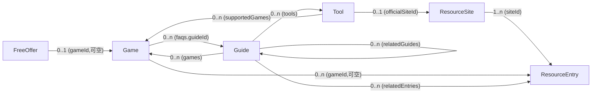

# 第四阶段：数据结构与内容规范

> 依据：`docs/02-信息架构与页面规划.md`、`docs/03-交互与业务逻辑.md` 及已确认产品边界。
> 本阶段只做数据建模、内容规范与发布规则。不含代码、不锁定 SSG 框架、不采集真实内容。
> 与既有文档关系：五类核心实体、五种免费类型、生命周期/链接健康双维度、最低发布标准机制等均为已确认结论，本文档只做数据层落地，不更改。

## 修订记录（本文档）

**2026-10-23 验收修订**（整体结构不变，修订六点）：

1. 新增字段适用范围表，区分通用字段/详情页实体专用字段/核验/链接健康/来源/SEO 字段的适用范围（§2 开头）
2. FreeOffer 生命周期重写：`permanent`/`opensource` 不适用生命周期；`trial` 按时间属性条件适用；日期异常与构建校验统一为"警告级+前台待确认"，消除"既待确认又阻断"的矛盾（§3、§4.5、§8.1）
3. 搜索索引补全间接搜索规则：Entry 关键词构建期合并进关联 Game/Site；FreeOffer 不进全站索引，`/free/` 本地查找承接（§8.4）
4. 平台与操作系统枚举统一：OS 类型/版本/获取平台/活动来源平台四概念分离并集中映射；新增核验周期配置规范（§4.9、§4.10；同步 Game/Tool/Guide/Channel/Offer 字段）
5. 示例与步骤规范加强：`_demo` 记录构建排除规则 + 独立示例目录、示例 JSON 语法修正与必填字段对齐、Step.ifFail 改为必填并约束默认值（§2.5、§7、§8、§10）
6. 五项待确认问题按验收决定归档，剩余参数级待确认项单列（§11）

**2026-10-23 二次一致性修订**（全量交叉审查，Schema 不变）：

7. 配置目录统一为根目录 `config/`（消除 §7 目录树 `data/config/` 与 §4.10 `config/site.json` 的两套路径并存），与 `docs/06` 项目结构一致（§7）
8. §8.3 补"统一展示资格定义"与"按实体发布结果表"：明确 published+达标不等于全部实体生成独立页——Entry 仅作入口展示、FreeOffer 仅进 `/free/` 与快报，二者无详情页/无独立搜索项/无 Sitemap 条目

---

## 第一部分：数据建模原则

| # | 原则 | 说明 |
|---|---|---|
| P1 | 稳定唯一 ID | 每条数据有不可变的内部 `id`，在其所属实体内唯一；实体间一律以 `id` 关联 |
| P2 | slug 与 ID 分离 | `slug` 只负责 URL，`id` 负责关联；展示名可改，`id` 永不改（slug 原则上也不改，变更流程见 §9.3） |
| P3 | 名称/别名/简介/地址分开管理 | 展示文本与原始 URL 是不同字段，不互相推导 |
| P4 | 关联用 ID，不复制数据 | 引用处只存 `id`；同一 ResourceSite 被多款游戏引用时站点信息只维护一份 |
| P5 | 状态维度分离 | 发布状态、内容核验状态、链接健康状态、活动生命周期是**独立字段或独立计算值**，绝不同字段混用 |
| P6 | 格式按内容选 | 结构化数据用 JSON；长篇自由文本用 Markdown；枚举集中定义，不在各文件里重复拼写 |
| P7 | 单一数据源 | 页面渲染、客户端搜索索引、Sitemap 全部从同一份数据文件构建，不维护第二份"展示用"数据 |
| P8 | 加内容 = 加数据文件 | 新增/修改内容原则上只动数据文件，不动模板与构建逻辑 |
| P9 | 小规模人工维护优先 | 规范为"一个人 + 文本编辑器"设计，同时保留向自动生成/协作扩展的余地 |

**数据分三层**（不得混放）：

| 层 | 内容 | 示例 |
|---|---|---|
| 核心实体 | 构成页面的五类实体 | Game / ResourceSite / ResourceEntry / Tool / Guide |
| 辅助记录 | 依附实体存在的运营数据与配置 | FreeOffer、站点配置、枚举表、slug 重定向表 |
| 构建产物 | 构建期生成、不入人工维护 | 页面 HTML、search-index.json、sitemap.xml、反向引用表、构建时间 |

---

## 第二部分：五类核心实体字段 Schema

通用约定：`[]` 后缀表示数组；`?` 表示可选/可空；枚举值见第四部分。

**字段适用范围表**（避免同一字段在不同实体承担冲突语义）：

| 字段 | Game | Site | Entry | Tool | Guide | FreeOffer | 适用规则 |
|---|---|---|---|---|---|---|---|
| `id` | ✅ | ✅ | ✅ | ✅ | ✅ | ✅ | 所有内容记录；创建后不可变 |
| `slug` | ✅ | ✅ | — | ✅ | ✅ | — | **仅有独立详情页的实体**；Entry/FreeOffer 无详情页，不需要 |
| `publishStatus` | ✅ | ✅ | ✅ | ✅ | ✅ | ✅ | 所有内容记录 |
| `createdAt` / `updatedAt` | ✅ | ✅ | ✅ | ✅ | ✅ | ✅ | 所有内容记录 |
| `checkedAt` | ✅ | ✅ | ✅ | ✅ | ✅ | ✅ | 所有内容记录；唯一含义＝"最近一次人工核验日期"，不兼作过期标记（过期 = checkedAt + 阈值的计算值） |
| `reviewStatus` | ✅ | ✅ | — | ✅ | ✅ | — | 有独立详情页的实体；Entry/FreeOffer 以 checkedAt + linkHealth 表达，不另设 |
| `linkHealth` | channels 内 | ✅ | ✅ | officialUrl 上 | — | ✅ | 仅挂在"用户点击跳转的目标地址"上；Guide 的 sources 属出处标注而非行动链接，不挂 |
| `sources` | ✅ | ✅ | ✅ | ✅ | ✅ | — | 信息来源；FreeOffer 的 url 本身即官方来源 |
| `seo` | ✅ | ✅ | — | ✅ | ✅ | — | 仅有独立详情页的实体 |

各实体表中的字段行均以此表为边界；不在适用范围内的字段不得出现在对应实体中。

### 2.1 Game

| 字段 | 类型 | 必填 | 说明 |
|---|---|---|---|
| `id` | string | ✅ | 稳定唯一 ID，建议语义可读（如 `elden-ring`），创建后不可变 |
| `slug` | string | ✅ | URL 用 `/games/{slug}/`，默认取 id，可独立指定 |
| `name.zh` / `name.en` | string / string? | ✅ / — | 中文名必填，英文名尽量填（搜索与消歧用） |
| `aliases` | string[] | — | 别名、常见错写、简称，仅服务搜索匹配 |
| `keywords` | string[] | — | 不参与展示的搜索关键词 |
| `summary` | string | ✅ | 2–3 句简介，最低发布标准之一 |
| `description` | string? | — | 详细介绍（Markdown 文本），可选 |
| `genres` | string[] | — | 类型 tag（如 `rpg` `simulation`），自由词表，录入规范约束写法 |
| `os` | enum[] | — | 操作系统类型枚举（见 §4.9），与"获取平台"严格区分 |
| `channels` | Channel[] | ✅≥1 | 官方获取渠道，见下表；最低发布标准要求≥1 |
| `cover` | object? | — | 可选封面：`{type: text \| placeholder \| image, src?, alt?}`；缺失时模板用文字封面，加载失败回退 |
| `savePaths` | {os?, path, note?}[] | — | 存档位置速查 |
| `configPaths` | {os?, path, note?}[] | — | 配置文件速查 |
| `faqs` | {question, answer?, guideId?}[] | — | 常见问题速查：`guideId` 优先内链教程，无则 `answer` 短答展开，二者至少其一 |
| `relatedGameIds` | id[] | — | 相关游戏（人工指定，优先于同 tag 规则式推荐） |
| `sources` | {name, url}[] | ✅≥1 | 信息来源 |
| `reviewStatus` | enum | ✅ | 内容核验 `unverified \| verified` |
| `checkedAt` | date | ✅ | 最近核验日期 |
| `createdAt` / `updatedAt` | date | ✅ | 内容创建/更新日期 |
| `publishStatus` | enum | ✅ | `draft \| published \| offline` |
| `seo.title` / `seo.description` | string? | — | 缺省由模板按规则生成，手写仅用于覆盖 |

**Channel（内嵌对象，非独立实体）**：

| 字段 | 说明 |
|---|---|
| `platform` | 获取平台枚举值（见 §4.9，如 `steam`/`epic`/`official`） |
| `type` | `buy \| free \| trial \| subscription` |
| `url` | 官方渠道页地址 |
| `priceNote` | 价格/费用说明文本 |
| `linkHealth` | 链接健康枚举 |
| `checkedAt` | 该渠道核验日期（可独立于游戏整体核验） |

**注意**：游戏页"关联资源/工具/教程"**不在 Game 上存列表**——ResourceEntry/Tool/Guide 各自持有指向 Game 的关联字段，构建时反查生成。FAQ 里的 `guideId` 是唯一例外（指向 Guide）。

### 2.2 ResourceSite

| 字段 | 类型 | 必填 | 说明 |
|---|---|---|---|
| `id` / `slug` | string | ✅ | 同 Game 规则，URL `/resources/{slug}/` |
| `name` | string | ✅ | 站点名 |
| `aliases` | string[] | — | 别名（如 "N网"） |
| `summary` | string | ✅ | 一句话简介 |
| `description` | string? | — | 详细介绍（Markdown） |
| `category` | enum | ✅ | 资源站分类（见 §4.6） |
| `url` | string | ✅ | 官网地址 |
| `languages` | string[] | — | 站点语言（`zh` `en` `multi`） |
| `feeNote` | string? | — | 费用/使用限制说明 |
| `purposes` | string[] | — | 主要用途 2–3 条 |
| `risks` | string[] | — | 风险提示（如"部分资源需注册""注意区分官方与转载"） |
| `linkHealth` | enum | ✅ | 官网链接健康 |
| `reviewStatus` | enum | ✅ | 内容核验状态 `unverified \| verified` |
| `checkedAt` | date | ✅ | |
| `sources` | {name,url}[] | — | |
| `publishStatus` / `seo` / `createdAt` / `updatedAt` | — | ✅ | 通用字段 |

**关联展示**：站点的"关联游戏"由其 ResourceEntry 的 `gameId` 反查生成，站点数据本身不存游戏列表。

### 2.3 ResourceEntry（资源入口）

| 字段 | 类型 | 必填 | 说明 |
|---|---|---|---|
| `id` | string | ✅ | 稳定标识（如 `nexus-stardew-mods`） |
| `name` | string | ✅ | 入口名（如"星露谷物语专区"） |
| `type` | enum | ✅ | `mod \| localization \| patch \| guide-page \| save \| tool-page \| other` |
| `siteId` | id | ✅ | 所属 ResourceSite（必填——入口必须挂在站点上） |
| `gameId` | id? | — | 关联 Game，**允许为空**（对应游戏未收录时不虚构 Game） |
| `url` | string | ✅ | 该站上的目标地址 |
| `note` | string? | — | 用途说明一句话 |
| `gameVersion` | string? | — | 适用游戏版本；不确定则留空并视为"待核验" |
| `platformNote` | string? | — | 适用平台补充说明 |
| `languages` | string[] | — | 资源语言 |
| `restrictions` / `risks` | string[] | — | 使用限制 / 风险提示 |
| `linkHealth` | enum | ✅ | 该入口链接健康（独立于 siteId 的健康状态——入口可死、站点可活） |
| `checkedAt` | date | ✅ | |
| `sources` | {name,url}[] | — | |
| `publishStatus` | enum | ✅ | |

**概念边界（已确认，重申）**：`ResourceEntry` = "某站上一个具体页面/专区"，`ResourceSite` = 站点本身。示例：`Nexus Mods` 是 Site；"Nexus 的星露谷物语专区"是 Entry，`siteId=nexus-mods`、`gameId=stardew-valley`。
**使用方式**：游戏详情页按 `gameId` 反查展示 Entry；资源站详情页按 `siteId` 反查"关联游戏"；`gameId` 为空的 Entry 不出现在任何游戏页，仅在站点详情或索引中可发现。

### 2.4 Tool

| 字段 | 类型 | 必填 | 说明 |
|---|---|---|---|
| `id` / `slug` | string | ✅ | URL `/tools/{slug}/` |
| `name` / `aliases` | string / string[] | ✅ / — | |
| `type` | enum | ✅ | 工具分类（见 §4.7） |
| `summary` | string | ✅ | 用途一句话 |
| `description` | string? | — | 详细用途（Markdown） |
| `os` | enum[] | — | 操作系统类型枚举（见 §4.9） |
| `osVersions` | enum[] | — | 操作系统版本枚举（见 §4.9），未知/不限则留空 |
| `supportedGames` | id[] | — | 支持的游戏 id；空数组 = 通用工具（不填假关联） |
| `officialUrl` | string | ✅ | 官方获取地址 |
| `officialSiteId` | id? | — | 官方渠道所属 ResourceSite（如 Vortex→Nexus），可选 |
| `version` | {latest?, checkedAt?} | — | **未知则不填**，展示为"待核验"，不写猜测版本号 |
| `compatibility` | string? | — | 兼容性说明；未知留空+待核验 |
| `installNotes` | string? | — | 安装使用要点（Markdown 有序步骤） |
| `limitations` / `risks` | string[] | — | 已知限制 / 风险（如"联机使用可能封号"） |
| `uninstallNote` | string? | — | 恢复/卸载方法 |
| `linkHealth` / `reviewStatus` / `checkedAt` | — | ✅ | |
| `sources` | {name,url}[] | — | |
| `publishStatus` / `seo` / `createdAt` / `updatedAt` | — | ✅ | |

### 2.5 Guide

| 字段 | 类型 | 必填 | 说明 |
|---|---|---|---|
| `id` / `slug` | string | ✅ | URL `/guides/{slug}/` |
| `title` | string | ✅ | |
| `kind` | enum | ✅ | `tutorial \| troubleshooting` |
| `category` | enum | ✅ | `install-run \| launch-crash \| mod \| save-backup \| settings-compat \| performance` |
| `keywords` | string[] | — | 搜索关键词，**报错原文原样收录** |
| `problem` | {description?, errorText?, conditions?} | — | 问题描述块；troubleshooting 必填 description |
| `games` | id[] | — | 适用游戏；空 = 通用教程 |
| `gameVersions` / `os` / `osVersions` | string? / enum[] / enum[] | — | 适用范围（os/osVersions 见 §4.9） |
| `prerequisites` | string[] | — | 前置条件 |
| `steps` | Step[] | ✅≥1 | 结构化排查/操作步骤，见下表——**最低发布标准要求≥1** |
| `recovery` | string[] | — | 恢复方法（卸载重装/还原备份等） |
| `tools` / `relatedGuides` / `relatedEntries` | id[] | — | 引用关联（均构建期解析为内链） |
| `sources` | {name,url}[] | ✅≥1 | 信息来源（官方文档/PCGamingWiki/社区帖） |
| `reviewStatus` / `checkedAt` | — | ✅ | |
| `publishStatus` / `seo` / `createdAt` / `updatedAt` | — | ✅ | |

**Step（结构化步骤，非自由文本）**：

| 字段 | 说明 |
|---|---|
| `title` | 步骤名（可选） |
| `action` | 具体操作（点哪里、改什么、运行什么）——必填 |
| `expected` | 预期结果——必填 |
| `ifFail` | **必填**：失败后的明确去向。不得依赖隐含默认——仅对只读/诊断类安全步骤（查版本、看报错、读日志）允许填"继续下一步"并在录入说明中注明理由；对修改系统/文件的操作必须写清失败分支（回退、跳步、停止并求助等） |
| `verified` | `self \| community \| unverified`：亲测 / 社区方案未核验 / 未核验——前台对应徽标 |

---

## 第三部分：免费活动记录的数据归属（FreeOffer）

### 方案比较

| 维度 | A. 独立辅助记录 `FreeOffer` | B. 并入 ResourceEntry 扩展类型 | C. 嵌入 Game.channels |
|---|---|---|---|
| 五实体边界 | 不破坏，活动是独立的"运营记录" | 破坏——Entry 语义是"站上某页面"，活动是"有生命周期的运营事件" | 部分破坏——channel 语义是"渠道"，不是"活动" |
| 关联未收录游戏 | `gameId` 可空，天然支持 | 需虚构 Site 归属或绕过必填约束 | **不支持**——必须先有 Game |
| start/end 管理 | 一等字段 | 为少数类型膨胀整个 Schema | 为少数渠道膨胀 |
| 与资源入口混淆 | 无 | 有——"Epic 限免页"到底是入口还是活动？ | 有 |
| 构建期归档 | 直接对一种记录跑规则 | 需按 subtype 分支处理 | 需额外标记 |
| 新增活动类型 | 加枚举值即可 | 继续膨胀 subtype | 更糟 |
| 维护复杂度 | 一个额外文件目录 | Schema 复杂度↑ | 渠道语义混乱 |

### 结论：**采用方案 A——`FreeOffer` 独立辅助记录**

它是核心五实体**之外**的辅助内容记录（与 site config、重定向表同层），不是第六类核心实体——页面由 FreeOffer 数据驱动但无独立详情页，只出现在 `/free/` 与首页快报。

**字段草案**：

| 字段 | 类型 | 必填 | 说明 |
|---|---|---|---|
| `id` | string | ✅ | 稳定 ID |
| `gameTitle` | string | ✅ | 展示用游戏名（无 Game 时也能展示） |
| `gameId` | id? | — | 可选关联已收录 Game；存在时卡片附"查看档案"内链；**不得为凑关联虚构 Game** |
| `type` | enum | ✅ | 五种免费类型之一 |
| `platform` | enum | ✅ | 活动来源平台枚举值（与获取平台同表，见 §4.9） |
| `url` | string | ✅ | 官方活动页地址（**必须是官方原始页面**） |
| `claimNote` | string? | — | 领取条件一句话（如"截止前领取即永久入库"） |
| `startDate` / `endDate` | datetime? | — | 活动起止；`endDate` 缺省走"截止不明"规则 |
| `checkedAt` | date | ✅ | 核验日期（生命周期判定的输入之一） |
| `linkHealth` | enum | ✅ | 活动页链接健康（独立于生命周期） |
| `note` | string? | — | 补充说明 |
| `publishStatus` / `createdAt` / `updatedAt` | — | ✅ | |

**生命周期不存储，按 §4.5 规则在构建期与运行期分别计算**——保证"构建归档权威 + 运行时兜底"的已确认行为。

**生命周期适用范围**（避免把长期内容误判为"截止不明"）：

| freeType | 生命周期 | 说明 |
|---|---|---|
| `permanent` / `opensource` | **不适用** | 非时效活动，不挂生命周期徽标；仅受 `linkHealth` 与"久未核验"提示约束 |
| `trial` | **条件适用** | 记录含 `startDate`/`endDate` 时按 §4.5 判定；无时间字段时按长期内容处理，不挂徽标 |
| `limited` / `weekend` | **适用** | 时效活动，必须有 `endDate` 参与判定（缺失走"截止不明"路径，见 §4.5） |

---

## 第四部分：统一枚举与状态规范

所有枚举集中在 `config/enums.json` 定义，存储值用英文小写，展示名用中文映射；校验时不在枚举表内的值一律报错。

### 4.1 发布状态 `publishStatus`

| 存储值 | 中文 | 前台行为 | 性质 |
|---|---|---|---|
| `draft` | 草稿 | 不生成页面、不进索引/Sitemap | 仅维护流程 |
| `published` | 已发布 | 达最低标准 → 生成页面 | 影响前台 |
| `offline` | 已下线 | 不生成页面、从索引/Sitemap 移除、关联处隐藏 | 影响前台 |

### 4.2 链接健康 `linkHealth`

| 存储值 | 中文徽标 | 触发条件 | 前台操作 |
|---|---|---|---|
| `ok` | 正常（不显式标出） | 已核验可访问 | 正常跳转 |
| `unchecked` | 待核验 | 尚未核验 | 可点击+徽标 |
| `suspect` | 疑似失效 | 构建检测不可达/用户反馈未复核 | 可点击+警示徽标+提示 |
| `dead` | 已失效 | 复核确认失效 | 禁用+徽标+替代+反馈 |

**链接可访问 ≠ 资源安全；未核验 ≠ 错误**——两状态只做可达性陈述。

### 4.3 内容核验 `reviewStatus`（与链接健康不同维度）

| 存储值 | 中文 | 含义 |
|---|---|---|
| `unverified` | 待核验 | 内容未人工核实 |
| `verified` | 已核验 | 内容经人工核实，`checkedAt` 记录核实日期 |

`checkedAt` 只记录"上次核实日期"这一个含义；"是否过期"由 checkedAt+阈值**计算**得出，不另存字段。

### 4.4 免费类型 `freeType`

| 存储值 | 中文 |
|---|---|
| `permanent` | 永久免费 |
| `limited` | 限时领取 |
| `trial` | 免费试玩 |
| `weekend` | 免费周末 |
| `opensource` | 开源 |

### 4.5 免费活动生命周期 `lifecycle`（**计算值，不存储**）

**适用前提**：仅 `limited` / `weekend`（及带时间字段的 `trial`）参与生命周期判定；`permanent` / `opensource` 无生命周期，不会落入"截止不明"。

**判定优先级（自上而下取第一个命中）**：

| 优先级 | 条件 | lifecycle | 中文徽标 |
|---|---|---|---|
| 1 | `endDate` 存在但 `startDate` 缺失/非法/`start > end` | `uncertain` | 状态待确认（数据异常） |
| 2 | `now > endDate` | `ended` | 已结束（归档区） |
| 3 | `now < startDate` | `upcoming` | 未开始 |
| 4 | 已超核验周期（无论有无 `endDate`；阈值见 §4.10） | `uncertain` | 状态待确认（久未核验） |
| 5 | 无 `endDate` 且未超核验周期 | `deadline_unknown` | 截止不明 |
| 6 | `startDate ≤ now ≤ endDate` 且未超核验周期 | `active` | 进行中 |

**组合情形对照**（与 `docs/03` §7.2 一致）：

| 组合 | 结果 |
|---|---|
| 已结束 + 核验过期 | `ended`（规则 2 先于 4） |
| 无 `endDate` + 核验过期 | `uncertain`（规则 4 先于 5） |
| 已结束 + 链接疑似失效 | `ended` + `suspect` 警示叠加；参考入口保留，不呈现领取操作 |
| `startDate > endDate` | `uncertain`（规则 1）——校验层记**警告**而非阻断（见 §8.1），单一规则不在两处给矛盾结论 |
| 无法可靠确认（兜底） | `uncertain`——不默认有效 |

**铁律**：人工维护的只有日期、checkedAt、linkHealth 等输入字段；`lifecycle` 恒由计算得出，**单一记录任何时刻只属于一个生命周期状态**；与 `linkHealth` 完全独立，互不判定对方。

### 4.6 资源站分类 `siteCategory`

`store`(正版商店) / `free-platform`(免费与试玩) / `indie`(独立游戏) / `mod`(MOD社区) / `localization`(汉化语言) / `guide-wiki`(攻略百科) / `patch-support`(补丁官方支持) / `other`(其他)

### 4.7 工具分类 `toolType`

`mod-manager` / `save`(存档工具) / `perf-monitor`(性能监测) / `game-manager`(管理辅助) / `trainer-channel`(修改器官方渠道) / `compat-fix`(兼容排障) / `other`

### 4.8 其余枚举

- 渠道类型 `channelType`：`buy` 购买 / `free` 免费 / `trial` 试玩 / `subscription` 订阅
- 入口类型 `entryType`：见 §2.3 表
- 教程 `kind`：`tutorial` / `troubleshooting`；`category`：六类见 §2.5
- 步骤核验 `stepVerified`：`self` / `community` / `unverified`

### 4.9 平台与操作系统枚举（四概念分离）

以下四个易混概念分别管理，标识统一存于 `enums.json`，字段中一律填写存储值，中文名仅展示层映射：

| 概念 | 使用字段 | 枚举（存储值 ↔ 中文） |
|---|---|---|
| 操作系统类型 | `os`（Game/Tool/Guide） | `windows` Windows / `linux` Linux / `macos` macOS |
| 操作系统版本 | `osVersions`（Tool/Guide，可选） | `win7`/`win10`/`win11`/`macos-13`…按需扩展 |
| 获取平台 | `Game.channels[].platform` | `steam`/`epic`/`gog`/`itch`/`official`官方站/`xbox-pc`/`other` |
| 活动来源平台 | `FreeOffer.platform` | **同一张平台枚举表**（一个表两用） |

规则：新增枚举值必须先登记 `enums.json`；`platformNote`、`note` 等自由文本仅作补充说明，不承担标识职责——不允许出现 `windows`/`win10`/`Win10` 多种写法表达同一概念。

### 4.10 核验周期配置（"久未核验"阈值）

- **配置位置**：`config/site.json` 的 `review.staleDays` 段，按记录类型分别配置
- **判定用途**：`checkedAt + staleDays < now` → 触发"久未核验"提示，或参与 §4.5 规则 4 的 `uncertain` 判定
- **建议初始值（参数级，待最终确认）**：

| 记录类型 | staleDays（天） |
|---|---|
| `limited` / `weekend` 活动 | 14 |
| `permanent` / `trial` / `opensource` 活动 | 90 |
| Game / ResourceSite / ResourceEntry / Tool | 90 |
| Guide | 180 |

- 原则：时效类内容周期显著短于长期内容；数值可在实施阶段调整，属参数而非结构变更

---

## 第五部分：时间规范

| 项 | 规则 |
|---|---|
| 日期格式 | `YYYY-MM-DD`（checkedAt/createdAt/updatedAt） |
| 日期时间格式 | ISO 8601 带时区：`YYYY-MM-DDTHH:mm:ss+08:00`；仅日期时也写作 `YYYY-MM-DD` |
| 时区 | 全站统一 **Asia/Shanghai（UTC+8）**；录入与判定均按此，不做本地化换算 |
| `endDate` 语义 | 仅日期 = 当日 23:59:59(+08:00) 前有效（含当日），避免时区换算提前结束活动 |
| `startDate`/`endDate` | 活动起止（录入值） |
| `checkedAt` | 人工核验日期；唯一来源是维护者操作，不由构建改写 |
| `createdAt`/`updatedAt` | 内容创建/最近编辑日期，人工或工具维护 |
| 构建时间 `buildTime` | 构建时由系统注入，展示于 /free/ 页头与页脚 |
| 缺失/非法日期 | 校验报错（格式非法）或按枚举规则处理（`endDate` 缺失→截止不明/待确认路径） |

---

## 第六部分：实体关联关系



| 关系 | 基数 | 关联 ID 存于 | 反向关联 | 缺关联处理 |
|---|---|---|---|---|
| Site→Entry | 1:n | Entry.siteId | 构建时反查→站点详情"关联入口/游戏" | siteId 必填，缺失=校验错误 |
| Game→Entry | 1:n(可空) | Entry.gameId | 构建时反查→游戏页"MOD与汉化" | 可空；指向不存在的 id=警告+该关联忽略 |
| Tool→Game | n:n | Tool.supportedGames[] | 反查→游戏页"工具与修改器" | 空数组=通用工具；悬空 id=警告+忽略 |
| Guide→Game | n:n | Guide.games[] | 反查→游戏页"相关教程" | 同上 |
| Guide→Tool | n:n | Guide.tools[] | 反查→工具页"相关教程" | 同上 |
| Tool→Site | n:1 | Tool.officialSiteId | 站点详情可反查"相关工具" | 可空 |
| Guide→Entry | n:n | Guide.relatedEntries[] | 反查(备用) | 同上 |
| Guide→Guide | n:n | Guide.relatedGuides[] | 反查"被引用"（可选展示） | 同上 |
| FreeOffer→Game | n:1(可空) | FreeOffer.gameId | 反查→档案页限时提示条 | 可空；悬空=警告+按未关联处理 |
| Game→Guide | 1:n | Game.faqs[].guideId | — | 可空（FAQ 可用 answer 代替）；悬空=警告+退化为无链接 FAQ |

**统一规则**：正向引用（存储的 id 列表）人工维护；反向引用（"被哪些游戏引用"等）一律构建时计算，不人工双向维护；引用对象缺失/未发布/已下线 → 构建时过滤该关联，不为空引用渲染占位。

---

## 第七部分：数据文件组织（技术无关）

```
data/
├── games/            # 每款游戏一个文件
│   └── stardew-valley.json
├── sites/            # 每个资源站一个文件
│   └── nexus-mods.json
├── entries/          # 每个资源入口一个文件
│   └── nexus-stardew-mods.json
├── tools/            # 每个工具一个文件
│   └── wemod.json
├── guides/           # 每篇教程一个 JSON（结构化字段+步骤）
│   ├── fix-0xc000007b.json
│   └── fix-0xc000007b.md        # 可选：长正文补充（注意事项/详细背景）
├── offers/           # 每条免费活动一个文件
│   └── epic-2026-xx-demo.json
├── pages/            # 静态单页正文（Markdown）
│   └── about.md
├── _examples/        # 示例数据专用目录（结构演示，绝不进入构建产物）
│   └── *.json
config/               # 根目录级配置（非 data/ 子目录；与 docs/06 项目结构一致）
├── site.json     # 站点名、域名、导航、页脚文案、核验周期 review.staleDays 等（唯一修改点）
├── enums.json    # 全部枚举：存储值 ↔ 中文名 ↔ 说明
└── redirects.json# slug 变更映射 old → new
dist/                 # 构建产物（不入版本管理/或不人工编辑）
├── (生成的 HTML)
├── search-index.json
├── sitemap.xml
└── robots.txt
```

**设计依据**：
- **一实体一文件**：小 diff、易审阅、无巨型 JSON、并行编辑不冲突；不追求"每游戏一文件夹"（v1 规模不需要）
- **JSON 存结构化字段**；**Markdown 只承担长自由文本**（教程补充正文、about 等静态页），步骤等结构绝不进 Markdown 散文本
- **config/ 集中**：站点名、枚举、重定向——单点修改
- **构建产物独立目录**：search-index、sitemap、反向引用、HTML 全部由构建生成，数据层不感知
- **目录方案与框架解耦**：任何 SSG/自写生成器都能消费此结构，本阶段不指定框架

---

## 第八部分：数据校验与发布规则

### 8.1 校验规则与级别

**构建排除（先于校验执行，不属于错误或警告）**：
- `_demo: true` 的记录**无条件跳过**，不生成页面/索引/Sitemap，无论其 publishStatus；示例数据统一放 `data/_examples/`，即使误放正式目录也不进入产物

**阻断级（构建失败，必须修复）**：
- `id` / `slug` 在同类实体内重复
- 必填字段缺失或为空
- 枚举值不在 `enums.json`
- `url` 非合法 http(s) 格式
- 日期格式非法（无法解析）
- **必填关联缺失**（Entry.siteId 指向不存在/未发布的 Site）
- `publishStatus` 非法
- JSON 语法错误

**警告级（记录日志，继续构建）**：
- **`startDate > endDate` 等日期语义异常**——数据错误但按既定业务规则呈现 `uncertain`（§4.5），警告提示维护者修复，不阻断构建（与第三阶段"状态待确认"前台规则统一，不再一处阻断一处放行）
- 可选关联悬空（指向不存在/未发布实体）→ 该关联被忽略
- `linkHealth=suspect/dead` 的已发布内容（照常发布，展示徽标）
- `checkedAt` 超阈值（页面照常，前台标"久未核验"）
- 可选字段缺失（封面、description 等）
- 达到 `published` 但不满足最低发布标准 → **跳过页面生成**+警告（视为数据不完整而非硬错误）

### 8.2 最低发布标准（未达 → 不生成页面、不进索引/Sitemap）

| 实体 | 标准 | 依据 |
|---|---|---|
| Game | `name.zh` + `summary` + ≥1 条 channel | 第二阶段已确认"简介+1条获取渠道" |
| ResourceSite | `name` + `url` + `summary` + `category` | 已确认（2026-10-23 验收，与必填字段一致） |
| ResourceEntry | `name` + `siteId` + `url` | 已确认（同上） |
| Tool | `name` + `summary` + `type` + `officialUrl` | 已确认（同上） |
| Guide | `title` + `kind`/`category` + ≥1 个合法 Step | 已确认（同上） |
| FreeOffer | `gameTitle` + `type` + `platform` + `url` + `checkedAt` | 已确认（同上） |

### 8.3 发布 / 下线 / slug 变更

- `draft` → 不生成页面，可存在于数据文件
- `published` + 达标 → 进入"前台展示资格集合"（见下表，各实体去向不同）
- `offline` → 不生成页面（URL 变为 404）、从索引与 Sitemap 移除；被引用处构建时过滤

**统一展示资格定义**：`可前台展示 = publishStatus:published ∧ 满足 §8.2 最低标准 ∧ 非 _demo`。页面、索引列表、关联模块、首页快报、搜索索引、Sitemap 全部消费同一资格集合，不得各自另行过滤。

**按实体发布结果**（"已发布"≠"都生成独立页面"）：

| 实体 | 达标后去向 | 独立详情页 | 全站搜索索引 | Sitemap |
|---|---|---|---|---|
| Game / ResourceSite / Tool / Guide | 详情页+所属索引页+关联模块+搜索+Sitemap | ✅ | ✅ | ✅ |
| ResourceEntry | 作为入口行展示于所属游戏页/站点页；不生成详情页，搜索中并入宿主 `linkedKeywords` | ❌ | ❌（间接可搜） | ❌ |
| FreeOffer | `/free/` 分区+页内查找+首页快报（未结束者） | ❌ | ❌ | ❌ |
- 被引用的实体下线 → 引用处隐藏该关联项；所在模块空则模块隐藏（与 §03 空态规则一致）
- **slug 变更**：写入 `redirects.json`（旧→新），构建时输出跳转；静态托管无服务端重定向时生成 meta-refresh 跳转页（实现细节属技术阶段）。原则：slug 尽量不改
- **阻断 vs 警告**分离：一条可选字段缺失绝不让整站发布失败

### 8.4 搜索索引 `search-index.json`

**收录对象**：`published` 且达最低发布标准的 Game / ResourceSite / Tool / Guide。每条含：`id`、`type`、`slug`、`name`、`aliases`、`keywords`、`summary`。

**ResourceEntry 间接可搜**（第一版不新增独立结果类型）：
- 构建时把 Entry 的 `name` 与搜索关键词合并进其关联 Game（`gameId` 存在时）或所属 Site（`siteId`）索引记录的 `linkedKeywords` 字段
- 搜索命中游戏/站点后，用户在详情页内可到达该入口；**无 `gameId` 的 Entry 至少可经所属 Site 被找到**——不依赖虚构 Game
- Entry 自身不产生搜索结果项，无独立落地页符合"索引项必有可落点页面"的约束

**FreeOffer 不进全站搜索索引**（已定案）：活动生命周期短、无详情页；`/free/` 页提供**页内本地关键词查找**（按游戏名、平台等过滤条目），使尚未收录 Game 的活动也能被找到。该交互需在 `docs/03` §7 补充定义（本次标记为跨文档同步项）。

**排除**：`draft` / `offline` / 未达最低标准 / `_demo` / 无落地页者——**索引项必有可落点页面**。

### 8.5 Sitemap 与索引许可（四概念区分）

| 概念 | 含义 | 规则 |
|---|---|---|
| 页面存在 | 有对应数据 | draft/offline 数据存在但页面不存在 |
| 页面可访问 | 生成了 HTML | 仅 published+达标 |
| 允许索引 | 未标 noindex | `/search/` 虽生成但 `noindex` |
| 进 Sitemap | 列入 sitemap.xml | = 可访问 ∧ 允许索引（/search/、404 不进） |

---

## 第九部分：内容录入与维护规范

| 操作 | 规则 |
|---|---|
| 新增游戏 | 新建 `games/{slug}.json`：先定 id/slug → 填 name/summary/channels/sources → 置 `draft`，补齐后改 `published`；FAQ/速查表可后补 |
| 新增资源站 | `sites/{slug}.json`：name/category/url/summary 为骨架 |
| 新增资源入口 | `entries/{id}.json`：**先确保 siteId 对应站点已存在**；gameId 对应游戏已收录才填，否则留空 |
| 新增工具 | `tools/{slug}.json`；版本/兼容不确定**留空**，不写猜测值 |
| 新增教程 | `guides/{slug}.json`；步骤按 Step 结构写，来源必填 |
| 新增免费活动 | `offers/{id}.json`；必须有官方活动页 url 与 checkedAt |
| 建立关联 | 只在规定的引用侧字段填目标 `id`（如 Tool.supportedGames），**禁止反向手填**——反查构建生成 |
| 枚举字段 | `type`/`category`/`platform`/`os`/`osVersions`/`linkHealth`/`publishStatus` 等一律填 `enums.json` 中的存储值（如 `epic`、`win10`），不写展示名或自由拼写；需要新值先登记枚举表 |
| 重复条目 | 录入前先按 name/aliases/url 搜索既有数据；重复则更新旧记录而非新建 |
| 失效链接 | 核实后 `linkHealth: dead`；未复核的用户反馈先记 `suspect` |
| 核验日期 | 每次人工核实内容/链接后更新 `checkedAt` 为当日 |
| 下线内容 | `publishStatus: offline`（不删文件，保留追溯）；slug 变更登记 `redirects.json` |
| 信息来源 | 新增/重大修改必须更新 `sources` |
| 无法核实的内容 | 保持 `unverified`/字段留空；**不得将猜测写成事实，不得虚构链接、价格、版本、兼容性、核验结果**；暂不够格的条目保持 `draft` 不上线 |
| FAQ/教程义务 | **维护者不必为每款游戏强填 FAQ 或教程**——模块空则隐藏 |

---

## 第十部分：示例数据（全部为结构演示，非真实收录）

> 以下数据为虚构演示：实体名、URL、内容均为占位示例。**统一存放于 `data/_examples/`，且全部含 `_demo: true`——构建无条件排除**（见 §8.1），不得进入正式网站。
> 以下 JSON 均为语法有效、可直接校验的结构，字段与本部分 Schema 必填要求一致。

**Game 示例** — `data/_examples/demo-valley.json`

```json
{
  "id": "demo-valley",
  "slug": "demo-valley",
  "name": { "zh": "示例谷物语", "en": "Demo Valley" },
  "aliases": ["示例谷"],
  "keywords": ["demo valley farm"],
  "summary": "一款虚构的农场模拟游戏，仅用于结构演示。",
  "genres": ["simulation"],
  "os": ["windows"],
  "channels": [
    {
      "platform": "steam",
      "type": "buy",
      "url": "https://example.com/demo-valley",
      "priceNote": "¥48（示例）",
      "linkHealth": "ok",
      "checkedAt": "2026-10-01"
    }
  ],
  "cover": { "type": "text" },
  "savePaths": [{ "os": "windows", "path": "%APPDATA%\\DemoValley\\Saves" }],
  "faqs": [{ "question": "启动白屏怎么办？", "guideId": "demo-guide" }],
  "sources": [{ "name": "官方页（示例）", "url": "https://example.com" }],
  "reviewStatus": "verified",
  "checkedAt": "2026-10-01",
  "createdAt": "2026-10-01",
  "updatedAt": "2026-10-01",
  "publishStatus": "published",
  "_demo": true
}
```

**ResourceSite 示例** — `data/_examples/demo-nexus.json`

```json
{
  "id": "demo-nexus",
  "slug": "demo-nexus",
  "name": "示例MOD站",
  "summary": "虚构的 MOD 社区，结构演示用。",
  "category": "mod",
  "url": "https://example.com/demo-nexus",
  "languages": ["en"],
  "purposes": ["下载与管理 MOD"],
  "risks": ["部分资源需注册"],
  "linkHealth": "ok",
  "reviewStatus": "verified",
  "checkedAt": "2026-10-01",
  "createdAt": "2026-10-01",
  "updatedAt": "2026-10-01",
  "publishStatus": "published",
  "_demo": true
}
```

**ResourceEntry 示例** — `data/_examples/demo-entry.json`

```json
{
  "id": "demo-entry",
  "name": "示例谷物语专区",
  "type": "mod",
  "siteId": "demo-nexus",
  "gameId": "demo-valley",
  "url": "https://example.com/demo-nexus/demo-valley",
  "note": "该游戏的 MOD 专区（示例）",
  "linkHealth": "ok",
  "checkedAt": "2026-10-01",
  "createdAt": "2026-10-01",
  "updatedAt": "2026-10-01",
  "publishStatus": "published",
  "_demo": true
}
```

**Tool 示例** — `data/_examples/demo-tool.json`

```json
{
  "id": "demo-tool",
  "slug": "demo-tool",
  "name": "示例存档备份器",
  "type": "save",
  "summary": "虚构的存档备份工具（结构演示）。",
  "os": ["windows"],
  "osVersions": ["win10", "win11"],
  "supportedGames": ["demo-valley"],
  "officialUrl": "https://example.com/demo-tool",
  "officialSiteId": "demo-nexus",
  "limitations": ["仅支持单机存档"],
  "risks": [],
  "linkHealth": "ok",
  "reviewStatus": "verified",
  "checkedAt": "2026-10-01",
  "createdAt": "2026-10-01",
  "updatedAt": "2026-10-01",
  "publishStatus": "published",
  "_demo": true
}
```

**Guide 示例** — `data/_examples/demo-guide.json`（含结构化步骤；`ifFail` 必填，只读步骤才可用"继续下一步"）

```json
{
  "id": "demo-guide",
  "slug": "demo-guide",
  "title": "示例：游戏闪退排查（演示）",
  "kind": "troubleshooting",
  "category": "launch-crash",
  "keywords": ["0xDEMO0001", "示例报错"],
  "problem": { "description": "启动后立即闪退（虚构示例）", "errorText": "0xDEMO0001" },
  "games": ["demo-valley"],
  "os": ["windows"],
  "osVersions": ["win10", "win11"],
  "steps": [
    {
      "title": "确认报错可复现",
      "action": "记录报错代码并再次启动游戏",
      "expected": "确认报错现象稳定复现",
      "ifFail": "继续下一步（只读操作，失败无系统改动）",
      "verified": "self"
    },
    {
      "action": "更新显卡驱动后重启电脑",
      "expected": "游戏正常启动",
      "ifFail": "回退到旧版驱动（见恢复方法），再执行下一步",
      "verified": "self"
    },
    {
      "action": "以管理员身份运行游戏",
      "expected": "游戏正常启动",
      "ifFail": "停止排查，前往来源帖反馈或提交本站反馈",
      "verified": "community"
    }
  ],
  "recovery": ["验证游戏文件完整性", "回退显卡驱动到旧版"],
  "tools": ["demo-tool"],
  "relatedGuides": [],
  "sources": [{ "name": "示例社区帖", "url": "https://example.com/post" }],
  "reviewStatus": "verified",
  "checkedAt": "2026-10-01",
  "createdAt": "2026-10-01",
  "updatedAt": "2026-10-01",
  "publishStatus": "published",
  "_demo": true
}
```

**FreeOffer 示例** — `data/_examples/demo-offer.json`

```json
{
  "id": "demo-offer",
  "gameTitle": "示例谷物语",
  "gameId": "demo-valley",
  "type": "limited",
  "platform": "epic",
  "url": "https://example.com/free-demo",
  "claimNote": "截止前领取即永久入库（示例）",
  "startDate": "2026-10-16T00:00:00+08:00",
  "endDate": "2026-10-23T23:59:59+08:00",
  "checkedAt": "2026-10-20",
  "linkHealth": "ok",
  "createdAt": "2026-10-16",
  "updatedAt": "2026-10-20",
  "publishStatus": "published",
  "_demo": true
}
```

---

## 第十一部分：决策记录与待确认问题

### 11.1 已定案（2026-10-23 验收，不再开放）

| # | 议题 | 决定 |
|---|---|---|
| 1 | ID 命名方案 | **语义可读、创建后不可变**（如 `elden-ring`）；人工维护友好，`id` 不可变约束保护引用稳定 |
| 2 | 最低发布标准 | **采用 §8.2 表内全部值**（与各实体必填字段保持一致，已标注"已确认"） |
| 3 | FreeOffer 与搜索 | **不进全站搜索索引**；由 `/free/` 页内本地关键词查找承接未收录游戏的活动（对应交互需在 `docs/03` §7 补充，见同步事项） |
| 4 | Guide 长正文格式 | **JSON 存结构化内容 + 允许同名 `.md` 补充长正文**（§7 文件组织已按此设计） |
| 5 | slug 重定向 | **`redirects.json` 为统一数据来源**；具体实现留技术阶段，优先托管平台原生重定向能力（如 `_redirects`），无原生能力时退回 meta-refresh 跳转页 |

### 11.2 剩余待确认（非阻塞，参数级）

| # | 问题 | 当前建议 | 说明 |
|---|---|---|---|
| 1 | 核验周期具体天数（§4.10 `staleDays`） | 时效活动 14 / 普通 90 / 教程 180 | 参数级调整项，实施阶段按数据量与更新频率定稿；不影响结构与构建逻辑 |
| 2 | `/free/` 本地查找的具体交互形态 | 页内即时过滤（沿用各索引页模式） | 属第三阶段交互文档的补充项，见下方同步事项 |

---

## 验收自查

- [x] 五类实体字段完整定义；ResourceSite 与 ResourceEntry 概念边界重申并有使用方式
- [x] 免费活动归属有明确结论：FreeOffer 独立辅助记录（非第六核心实体）
- [x] 全部枚举统一存储值↔中文名；生命周期与链接健康完全独立（前者计算值后者存储值）
- [x] 时间格式与时区明确；`endDate` 仅日期语义避免时区提前结束
- [x] 关联关系表覆盖说明要求的全部 8 种关系，含基数、存储方、反查与缺关联处理
- [x] 文件组织技术无关，未锁定 SSG
- [x] 校验分级（阻断/警告）、最低发布标准、下线与重定向、四概念区分均已定义
- [x] 示例含 `_demo:true` 标记且声明不进入正式网站
- [x] 未编写代码、未指定技术框架、未采集真实内容
